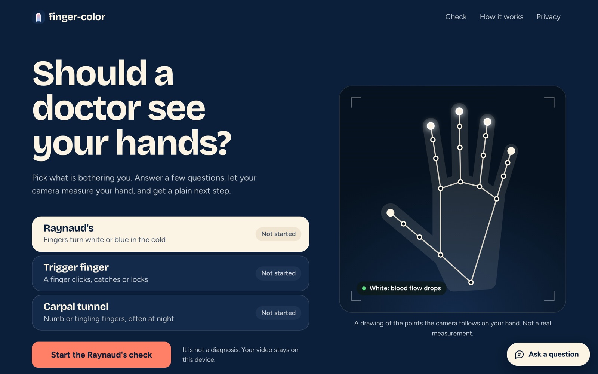
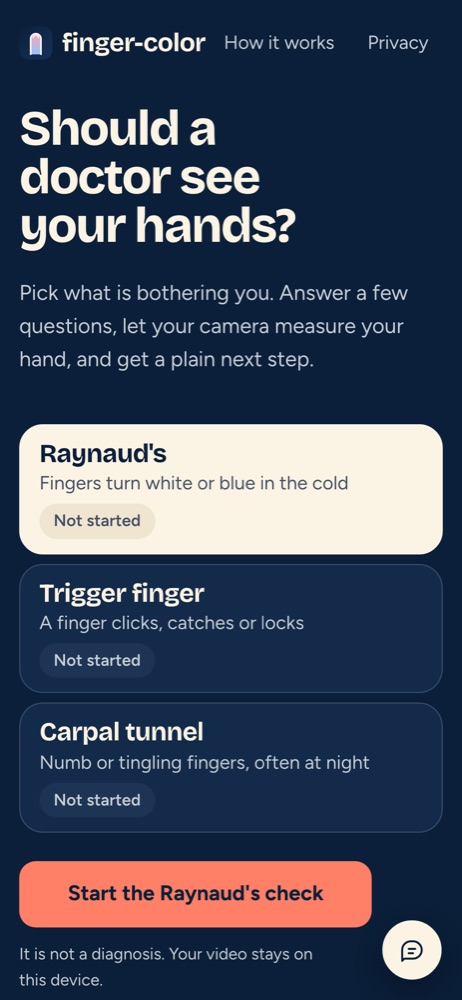
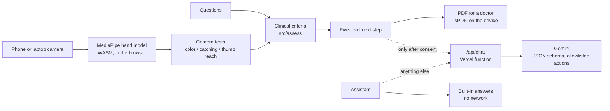

# finger-color: should you see a doctor about your hands?

**Live app:** https://finger-color.vercel.app

A browser app that compares a person's hand symptoms with the hallmark features of three common conditions, using published clinical criteria, guided self-tests and a phone camera. It ends with a clear next step (from "unlikely" to "get care today") and a PDF report to bring to an appointment.

> Student research project. Not a medical device. It does not diagnose any condition. Camera thresholds are engineering values that have not been validated on patients.

[](https://github.com/Samuel0720-source/finger-color/actions/workflows/test.yml)

<p>
  
  
</p>

## For reviewers: what this project shows

| Area | What was built | Where |
| --- | --- | --- |
| Computer vision | Real-time hand tracking (MediaPipe, 21 landmarks) in the browser; joint angles from 3D vectors; catch detection with frame-rate and frame-gap gates | `src/hand.js`, `src/angles.js`, `src/tests/trigger-test.js` |
| Color science | sRGB → linear RGB → CIE XYZ → CIELAB, palm-relative ΔE, 3-sample median phases, recovery timing | `src/color.js`, `src/assess/color-analysis.js` |
| Clinical logic | Published criteria turned into code (Raynaud's consensus, Green grades, CTS-6) with a five-level next step | `src/assess/` |
| Backend and LLM safety | Serverless endpoint with input validation, rate limits, timeouts, a JSON schema for the model, an action allowlist, and urgent-symptom answers that never reach the AI | `api/chat.js`, `server/chat-core.js`, `src/assistant/safety.js` |
| Privacy by design | Video never leaves the device; a result is sent to the AI only after the user sees exactly which lines and presses "send" | `src/assistant/chat.js` |
| Security | Content-Security-Policy and other headers, tested on every push against the built site | `vercel.json`, `tests/e2e/smoke.mjs` |
| Testing | 100 unit tests, a browser test of all three checks with a generated fake camera video, a production smoke test, a synthetic benchmark and a 50-person simulated population | `tests/`, `validation/` |
| Data analysis | Python re-analysis that must agree with the app (parity check in CI), validation reports with ICC and agreement statistics | `analysis/`, `docs/validation/` |
| Accessibility | Keyboard-navigable steps, live result announcements, focus management, phone layout | `index.html`, `src/steps.js` |

### How the pieces fit



Everything left of the dotted lines runs on the device. The only server code is `/api/chat`.

### Engineering log: an independent second review (November 2026)

The code was reviewed by a second AI model from a different provider, with no shared context, looking for production failure paths. Each finding was checked against the code before changing anything. Fixed, each with a test:

- After choosing "explain on this device", the explanation could still be sent with the *next* AI question. It now stays on the device; a browser test checks the request body.
- A recording interrupted by a hidden page was still scored for color phases. It is now never scored.
- With a saved normal color but no warming mark, a red phase could be reported as "red after warming". Red now needs the warming mark.
- If the camera was unplugged while the hand model was loading, the page could show a live camera with no stream.
- A malformed saved record could stop the history panel from loading; a failed save of a color result was not reported; an old "Try again" button could send the wrong conversation.
- No Content-Security-Policy. Added, plus a smoke test that fails if the policy blocks anything the app needs (checked by removing one rule on purpose).

Not changed: the chat rate limit lives in memory per server instance, so it guards against bursts but is not an exact meter. A deliberate trade-off (no database), described under the assistant below.

## How a check works

Every condition follows the same three steps:

1. **Your symptoms.** Questions taken from the clinical criteria, plus warning signs that change the advice.
2. **Measure.** The camera (and, for carpal tunnel, three guided tests) checks the features it can.
3. **Result.** Each feature is marked *present*, *absent* or *not checked*, with how it was checked (your answer, guided test, or camera). The criteria then set one of five levels:

| Level | Meaning |
| --- | --- |
| Unlikely | Few or no hallmark features |
| Self-care | Mild pattern; self-care first, see a doctor if it does not improve |
| Routine appointment | Criteria met; book a normal appointment |
| See a doctor soon | Signs of more severe or secondary disease; within 1 to 2 weeks |
| Get care today | Red-flag sign (for example a black fingertip or a hot, swollen finger) |

The summary is generated from the table, for example: *"5 of 7 carpal tunnel features are present. Measured by camera: thumb could not reach the little finger. Guided test: Phalen test reproduces tingling (after 3 s). You reported: numbness at night ..."*

## The three conditions

| Condition | Criteria used | What the camera measures |
| --- | --- | --- |
| Raynaud's phenomenon | International consensus criteria (Maverakis et al. 2014): cold sensitivity + white/blue color change, then at least 3 of 7 supporting features. Secondary-cause signs from the Merck Manual. | Color phases (white, blue, red) per finger, number of fingers involved, whether the thumb is spared, whether the border is sharp (tip changes, finger base does not), and recovery time after rewarming |
| Trigger finger | Green grades I to IV | Catching (a stop then a snap while opening the fist), whether each finger and the thumb fully straighten and fully bend (largest and smallest joint angle) |
| Carpal tunnel syndrome | CTS-6 (score of 12 or more of 26 = likely) and NHS urgent signs | Thumb reach (opposition) test: can the thumb touch each fingertip. Phalen, Tinel and two-point tests are guided self-tests. |

## The assistant ("Ask a question")

A chat panel that explains the tests, helps with camera problems, moves you to the right step, and explains a result in plain words, in English or Korean. It is general information, never a diagnosis.

How one question is answered, in order:

1. **Urgent wording** (a black fingertip, sores, a red hot swollen finger, sudden weakness) gets a fixed "get care today" message. No AI is involved.
2. **Common questions** are answered on the device from a hand-written list (`src/assistant/knowledge.js`), checked against the app and against NIAMS and NHS pages.
3. **Anything else** goes to `POST /api/chat`, a Vercel serverless function that calls Google Gemini (`gemini-3.5-flash-lite`, free of charge on the Free Tier when checked on 15 Nov 2026).
4. **If the AI is off or fails** (no key, quota used up, timeout), the built-in list answers instead.

Safety and privacy choices:

- The API key is read only on the server (`GEMINI_API_KEY`). It is never in the page, the build or the repository.
- The model must answer as `{reply, actions}`. The reply is shown as plain text, and `actions` may only hold ids from a fixed list (`src/assistant/actions.js`) that map to places in the app. No URL or code from the model is ever run.
- The model is given the rules in `src/assistant/safety.js`: no diagnosis, no medicines or doses, no invented numbers, app facts only from the knowledge list, user text treated as data.
- A result is **never sent by itself**. "Explain my result" first shows exactly which lines would be used and offers two buttons: explain on this device (nothing sent) or send to the AI.
- Only six facts about the page are sent with a question: which check, which step, whether the user is in the check, camera on, test running, result available. No answers, video or names.
- Limits: 500 characters per message, 6 recent messages per request, 6 requests per minute and 40 per day per visitor, 300 per day in total, 12 s timeout. The counters live in memory, so they reset when the function restarts: a guard against bursts, not an exact meter.
- On the Gemini Free Tier, Google may use what is sent to improve its products. The chat says so and asks people not to type personal details. Conversations are not stored by this app.

**Turn the AI on (free):** create a key at [aistudio.google.com/apikey](https://aistudio.google.com/apikey), then on Vercel open the project, Settings, Environment Variables, add `GEMINI_API_KEY` for Production, and redeploy. Do not add a billing account to the Google project if you want it to stay free. `.env.example` lists the optional settings. Without a key everything still works; the assistant just answers from its built-in list.

## Camera methods

**Finding the hand.** MediaPipe Hand Landmarker returns 21 landmarks per frame, both in image pixels and as 3D points in meters (world landmarks).

**Color (Raynaud's).** Boxes on each fingertip, on each finger base and on the palm are averaged and converted sRGB → linear RGB → CIE XYZ → **CIELAB**. Each finger is compared with the palm in the same frame to reduce lighting effects. The change score is the CIELAB distance (ΔE) from a reference.

- Reference: a saved "normal color" baseline, or, in episode mode, the last 10 s of the recording (when the hand has warmed back up).
- A phase (white, blue, red) counts when ΔE is 6 or more in 2 of 3 consecutive samples. Red only counts after warming starts.
- Sharp border: the finger base changed less than 40% as much as the tip.
- Recovery: trailing 10 s average must stay below threshold for 30 s, at least 60 s after warming.

**Joint angles (trigger finger).** The angle at each middle (PIP) joint, and at the thumb's IP joint, from 3D vectors (`src/angles.js`). A catch is a window of at least 150 ms with less than 8° movement in the 100–165° band, followed by a gain of 25° within 120 ms. A finger is flagged as "does not straighten" or "does not bend" only when at least two other fingers reached the position, so a lazy fist does not count. Scoring needs 10 cycles, 25+ fps and no frame gap over 100 ms.

**Thumb reach (carpal tunnel).** The thumb-tip to fingertip distance divided by hand size. Below 0.2 for 5 frames in a row (about 0.17 s) counts as a touch; 6 s per fingertip, 20 s in total, and the hand must be tracked in at least 80% of frames. Not reaching the little finger is treated as possible thumb (thenar) weakness.

## Project structure

```
src/
  main.js            page wiring: modes, camera loop, results, PDF
  questionnaire.js   Yes / No / Not sure questions, finger chips, warning signs
  result-panel.js    verdict, score, feature table, why / what to do / limits
  doctor-report.js   PDF report for a clinician
  phase-strip.js     per-finger color phase chart (white / blue / red over time)
  assess/
    levels.js          the five levels, feature helper, generated summary
    raynaud.js         consensus criteria + secondary-cause signs
    trigger.js         Green grades
    carpal.js          CTS-6 score + urgent signs
    color-analysis.js  phases, fingers involved, border, recovery from a recording
  tests/
    trigger-test.js    catch detection math
    color-panel.js     Raynaud's recording screen (normal color, recording, warming, analysis)
    trigger-panel.js   catching screen (five fingers including the thumb)
    reach-panel.js     thumb reach test
    cts-guided.js      Phalen (timed), Tinel and two-point cards
  assistant/
    knowledge.js       hand-written answers (English and Korean) and their sources
    faq.js             answers common questions on the device, no AI
    safety.js          urgent-symptom check, and the rules given to the AI
    actions.js         the fixed list of things the assistant may do in the app
    result-summary.js  the result lines that may be shared, and the on-device explanation
    launcher.js, chat.js, chat.css   the button and the panel (the panel loads on first use)
  setup-check.js     camera setup tips under the video
  evidence.js        "What has been tested so far", read from the validation results
  build.js           the commit this page was built from
  steps.js           the three-step bar (Symptoms, Measure, Result)
  hero-hand.js       the animated hand drawing at the top of the page
  camera.js, hand.js, color.js, plain.js, recovery.js, recorder.js,
  livechart.js, chart-theme.js, angles.js, draw.js, history.js, history-panel.js
api/chat.js          the serverless endpoint for the assistant (reads GEMINI_API_KEY)
server/chat-core.js  its logic: input checks, rate limits, prompt, cleaning the model's answer
tests/               node --test unit tests (assessments, color analysis, detectors, assistant)
tests/e2e/           browser test of all three conditions with a generated fake camera video,
                     and smoke.mjs: the built site under the real headers
validation/          synthetic benchmark, Python parity check, 50-person simulated population test
analysis/            Python re-analysis of exported CSV files
.github/workflows/   runs every check below on each push
```

## Run it

```bash
npm install
npm run dev         # https://localhost:5173 (self-signed certificate)
npm test            # unit tests
npm run build
npm run benchmark   # synthetic detector benchmark
npm run parity      # Python analysis gives the same recovery time as the app (needs pandas, numpy)
npm run population  # 50 simulated people: skin types, lights, ages, imperfect answers
npm run e2e         # real app in Chrome with a fake camera, all three conditions and the assistant (about 2.5 min)
npm run e2e -- assistant   # only the assistant checks (a few seconds)
npm run smoke       # after npm run build: the built site with the Vercel headers, real hand model, PDF, no CSP violations
```

GitHub runs all of these on every push (`.github/workflows/test.yml`).

`npm run dev` serves the page only, so the assistant answers from its built-in list there. To try the AI locally, use `npx vercel dev` with a `.env.local` copied from `.env.example`.

**Optional: serve the hand model yourself.** The app downloads the MediaPipe hand model (about 8 MB) from Google. To host it with the site, so it still works if that link changes, download [hand_landmarker.task](https://storage.googleapis.com/mediapipe-models/hand_landmarker/hand_landmarker/float16/1/hand_landmarker.task) into `public/models/` and change `MODEL_URL` in `src/hand.js` to `'/models/hand_landmarker.task'`. Test with a real hand before pushing.

Open the Network URL on a phone on the same Wi-Fi to use the back camera.

## What changed in November 2026

- New design: one step on screen at a time (Symptoms, Measure, Result) and a drawing of the hand points the camera follows.
- Added the assistant (see above).
- Camera setup tips under the video: hand found, whole hand in the picture, camera fast enough. Tips only; scoring is unchanged.
- The page shows its build (commit) in the footer, and it is written into the PDF and the trigger finger run summary, so a measurement can be traced to the code that produced it.
- "Download run summary (CSV)" after every trigger finger run, scored or not, for the validation files.
- "What has been tested so far" on the page: the pilot numbers straight from `results.json`, including the rules that are not met.
- Security headers in `vercel.json` (no framing, camera only for this site, no microphone or location), and a Content-Security-Policy checked by `npm run smoke`.

- Added the feature table and five-level result for all three conditions, with criteria-based questions.
- Added Raynaud's color phases, fingers involved, thumb sparing, sharp border and episode mode.
- Added thumb tracking and per-finger range to the catching test.
- Added the thumb reach test and guided Phalen, Tinel and two-point tests (CTS-6).
- Added one doctor PDF per condition.
- Removed the thumb tapping test: tapping speed is not part of any carpal tunnel criteria, so it could not support a recommendation.
- A simulated population test (50 people) found and fixed: "Not sure" answers ending the check as "unlikely", the urgent Raynaud's question hidden behind a "Yes", warning signs ignored when the blue phase was missed, false color changes in dim light, and jitter faking thumb touches. Details: `validation/README.md`.
- Episode mode now refuses to use the end of a recording as "normal" when a fingertip is still paler or bluer than the base of the finger.
- The Python analysis matches the app again (it had fallen behind algorithm 3 and episode mode).
- Accessibility: 44 px touch targets, no text under 12 px, and one short screen-reader announcement when a result changes. axe-core reports 0 issues.

## Validation

Each camera test has a fixed protocol and three reports: a dry run of the analysis, a 3-person pilot, and a 10-person study. Report 01 (dry run) is done for trigger finger and Raynaud's: the analysis recovered every answer built into simulated data. Report 02 (pilot) for trigger finger is in progress with real measurements from two healthy volunteers; it states which pass rules currently fail and why. See [`docs/validation/`](docs/validation/README.md).

## Limits

- Camera thresholds are engineering choices tested on synthetic signals and scripted e2e runs, not on real patients.
- Phone cameras change exposure and white balance. Skin tone, nail polish, lighting and hand position change color readings. Compare a person with their own reference.
- Self-done Phalen, Tinel and two-point tests are less reliable than when a clinician does them.
- On darker skin the camera can miss a blue phase under indoor light (simulation: 7–8 of 10 on Fitzpatrick VI, 10 of 10 on I–IV). Dim light is not scored at all.
- Do not expose hands to cold on purpose to get a result.

## Author

Samuel Koo, Biomedical Engineering, University of Waterloo
