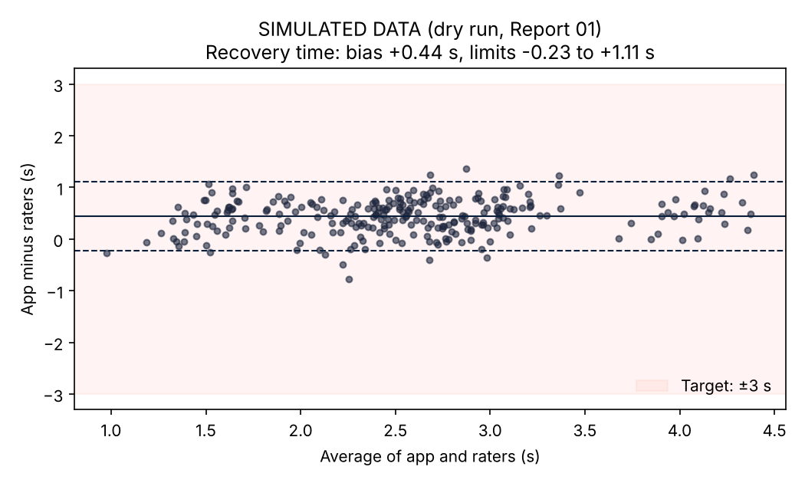

# Report VR-RAY-01: Raynaud's color, dry run of the analysis

| | |
| --- | --- |
| Protocol | [VP-RAY-001](../protocol-raynaud.md) v1.0 |
| Data | Simulated. No people took part and the app was not run. |
| Date | 10 Nov 2026 |
| Author | Samuel Koo |
| Result | The analysis found every answer built into the data. Ready for Report 02. |

## Why a dry run

Before measuring real people, I needed to know the analysis itself is right. So I made fake data with known values built in (for example, "the app times recovery 0.4 s too late"), ran the real analysis script on it, and checked that it reported those same values.

The numbers below describe the simulated data only. **They say nothing about how accurate the app is.** Report 02 is the first with real measurements.

## What was built in, and what the analysis found

| Check | Built in | Found | Allowed gap | Result |
| --- | --- | --- | --- | --- |
| Still-hand samples below 3 | 90% | 90% | ±2% | match |
| Pressed fingertips seen (above 3) | 282 of 300 | 282 of 300 | exact | match |
| Presses the app could not time | 30 of 300 | 30 of 300 | exact | match |
| Recovery time bias | +0.40 s | +0.44 s | ±0.06 s | match |
| Spread of differences (SD) | 0.33 s | 0.34 s | ±0.05 s | match |
| ICC formula on a published example (Shrout and Fleiss, 1979) | 0.29 | 0.29 | ±0.005 | match |

The allowed gap for the bias is three standard errors: random noise alone stays inside it more than 99% of the time.

## The pass or fail table works too

The still-hand noise was built in so that only 90% of samples stay below 3, under the 95% the protocol asks for. So AC-1 should fail, and it does.

| ID | Rule | Simulated result | |
| --- | --- | --- | --- |
| AC-1 | 95% of still samples below 3 | 90% (95th percentile 3.6) | FAIL |
| AC-2 | 90% or more presses seen | 282 of 300 (94%) | PASS |
| AC-3 | Bias within ±1 s | +0.44 s | PASS |
| AC-4 | Limits within ±3 s | −0.23 s to +1.11 s | PASS |
| AC-5 | ICC 0.6 or higher | 0.98 | PASS |
| AC-6 | Fewer than 1 in 5 not timed | 30 of 300 (10%) | PASS |

The two simulated raters differed by 0.23 s on average, and no press needed a third rater.



## Repeat it

```
python analysis/validation/dryrun.py check
```

This rebuilds the simulated data from a fixed seed (20261110), runs the analysis and prints the first table. It also runs on GitHub on every push. The simulated CSVs used here are in [`data/raynaud/`](data/raynaud/).

## Changes from the first draft

The first draft (v0.2, PDF) reported generated "results", such as noise reaching 7.5, as if they were findings, along with 12 fictional participant profiles. No scripts or data came with it to reproduce those numbers. This version replaces it with a check whose answers are chosen in advance, and whose code and data are in the repository.

## Next: Report 02, pilot

- **Who:** me and 2 volunteers who meet the protocol's rules.
- **What:** one session each, normal light: the still-hand recording and 10 presses, filmed for two raters.
- **Goal:** find problems with the steps (is "back to normal" easy to mark on video? does the camera shift color on its own?) and get a first real look at noise and timing.
- **Pass or fail:** reported, but marked provisional, because 3 people is too few to decide anything.
- **Then:** Report 03, the full study (10 people, 3 sessions, both light conditions).
