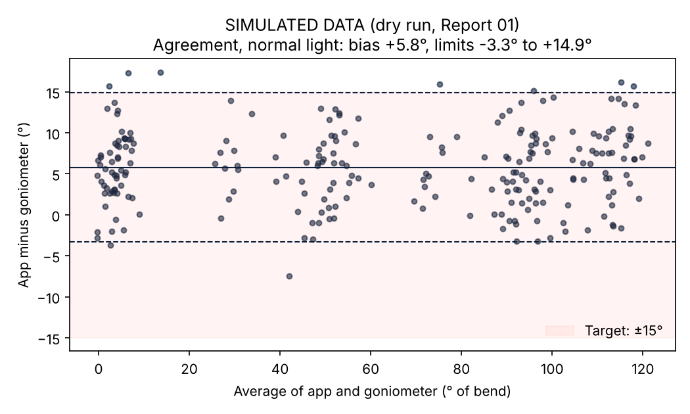

# Report VR-TF-01: Trigger finger, dry run of the analysis

| | |
| --- | --- |
| Protocol | [VP-TF-001](../protocol-trigger-finger.md) v1.0 |
| Data | Simulated. No people took part and the app was not run. |
| Date | 10 Nov 2026 |
| Author | Samuel Koo |
| Result | The analysis found every answer built into the data. Ready for Report 02. |

## Why a dry run

Before measuring real people, I needed to know the analysis itself is right. So I made fake data with known errors built in (for example, "the app reads 6° too much"), ran the real analysis script on it, and checked that it reported those same errors. If it can't recover an answer I chose myself, it can't be trusted with data I don't know the answer to.

The numbers below describe the simulated data only. **They say nothing about how accurate the app is.** Report 02 is the first with real measurements.

## What was built in, and what the analysis found

| Check | Built in | Found | Allowed gap | Result |
| --- | --- | --- | --- | --- |
| Average difference (bias) | +6.0° | +5.8° | ±0.9° | match |
| Spread of differences (SD) | 4.7° | 4.6° | ±0.7° | match |
| Deliberate catches found | 24 of 30 | 24 of 30 | exact | match |
| Smooth fists flagged | 15 of 300 | 15 of 300 | exact | match |
| Runs not scored | 4 of 40 | 4 of 40 | exact | match |
| ICC formula on a published example (Shrout and Fleiss, 1979) | 0.29 | 0.29 | ±0.005 | match |

The allowed gap for the bias is three standard errors: random noise alone stays inside it more than 99% of the time.

**The check can fail.** To make sure, I deliberately broke the angle conversion (dropped the "180° − app angle" step). The check then reported a bias of 55.8° instead of 6° and failed, as it should. With the step put back, it passed again.

## The pass or fail table works too

On the same simulated data, the script fills in the protocol's table. The bias was built in at 6°, just over the 5° limit, so AC-1 should fail, and it does.

| ID | Rule | Simulated result | |
| --- | --- | --- | --- |
| AC-1 | Bias within ±5° | +5.8° | FAIL |
| AC-2 | Limits within ±15° | −3.3° to +14.9° | PASS |
| AC-3 | ICC 0.75 or higher | 0.85 | PASS |
| AC-4 | 80% or more catches found | 24 of 30 (80%) | PASS |
| AC-5 | 10% or fewer false alarms | 15 of 300 (5%) | PASS |
| AC-6 | Fewer than 1 in 5 not scored | 4 of 40 (10%) | PASS |



## Repeat it

```
python analysis/validation/dryrun.py check
```

This rebuilds the simulated data from a fixed seed (20261110), runs the analysis and prints the first table. It also runs on GitHub on every push, so a change that breaks the analysis turns the build red. The simulated CSVs used here are in [`data/trigger/`](data/trigger/).

## Changes from the first draft

The first draft (v0.2, PDF) reported generated "results", such as a 20° bias, as if they were findings, along with 12 fictional participant profiles. No scripts or data came with it to reproduce those numbers. This version replaces it with a check whose answers are chosen in advance, and whose code and data are in the repository.

## Next: Report 02, pilot

- **Who:** me and 2 volunteers.
- **What:** one session each, normal light only, steps 1 to 3 of the protocol.
- **Goal:** find problems with the steps themselves (unclear instructions, a goniometer that's hard to read, runs that don't score) and get a first real look at the bias.
- **Pass or fail:** reported, but marked provisional, because 3 people is too few to decide anything.
- **Then:** Report 03, the full study (10 people, 3 sessions, both light conditions), with any protocol fixes from Report 02 listed in a new protocol version.
