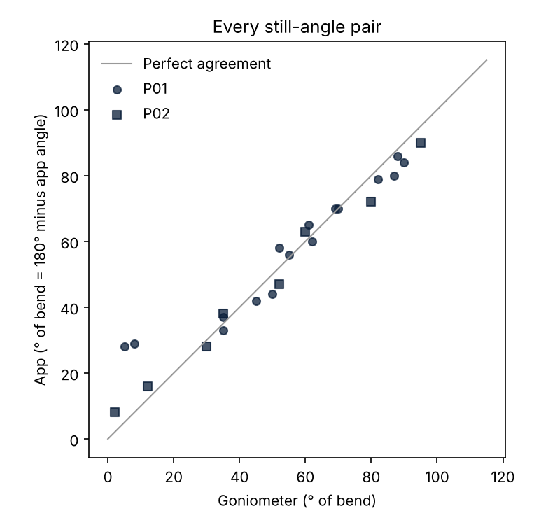
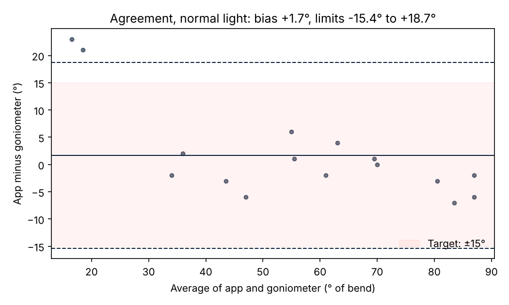

# Report VR-TF-02: Trigger finger, pilot

| | |
| --- | --- |
| Protocol | [VP-TF-001](../protocol-trigger-finger.md) v1.2 for the data so far; v1.3 from the next session |
| Data | Real measurements of healthy adults. Nothing simulated. |
| Author | Samuel Koo (also participant P01 and the person who reads the goniometer) |
| Volunteers | P02 and P03 (friends of the author) |
| Result | Pilot complete for 3 people (20 Nov 2026). One more catch run is planned; the tables update when it is added. |

How this file works: the tables and figures between the `auto` markers are rebuilt from the CSV files by `analysis/validation/make_report.py`. When a volunteer's data is added, run it again and every number updates. The text around the tables was written on the dates shown and is not touched.

## Summary (20 Nov 2026)

Three healthy adults, 32 goniometer pairs and 10 fist runs. The rules were fixed before any data was taken and have not been changed.

| Question | Answer from the pilot |
| --- | --- |
| Does the bend angle match a goniometer? | On average yes (+0.5°, AC-1 passes). The spread is just too wide: limits −14.9° to +15.8° against ±15° (AC-2 fails by under 1°). A straight finger reads too bent in every hand. |
| Does a smooth fist get flagged as a catch? | Not on the middle finger: 0 of 68 (AC-5 passes). The thumb is flagged in every hand (8 false catches in 3 smooth runs). |
| Is a deliberate catch found? | 9 of 12 (AC-4 fails). All 3 missed were P03's, made from an open hand instead of a full fist, in a finger that opens only to about 142°. |
| Does the test finish? | 2 of 10 runs not scored, both on the first build (AC-6 fails at exactly 1 in 5). Since the 12 Nov fix, 8 of 8 scored. |
| Is it repeatable from day to day? | Not measured yet (AC-3 needs Report 03). |

**What the pilot changed:** the fist lines now follow each person's own open hand (two of three hands read only 141° to 142° when open, and the old lines would have counted 0 of 10 of P03's fists); held fists no longer count as catches on the little finger; the volunteer guide now shows the catch step.

**What Report 03 must decide first:** how to read a straight finger, what to do about the thumb, whether a catch from an open hand counts, and whether the snap size should depend on how far the finger opens. Each change is designed on some people and tested on people who were not used to design it.

## 1. Where things stand

<!-- auto:status -->
| | |
| --- | --- |
| People | 3 (P01, P02, P03) |
| Person-sessions | 5 |
| Still-angle pairs | 32 (middle finger; 3 people) |
| Runs | 10 (8 scored) |
| App builds | c74e3a4, c9727ef, d75db24, not-recorded, caff658 |
| Updated | 20 Nov 2026 |
| Status | Provisional: 3 people, healthy volunteers. Too few to decide pass or fail; the numbers show what to fix. |
<!-- /auto:status -->

## 2. What was tested

Whether the finger-color trigger finger test measures how far the middle finger bends, compared with a goniometer, and whether it finds a deliberate catch without flagging smooth fists. The healthy volunteers cannot show whether the app detects trigger finger. See the [protocol](../protocol-trigger-finger.md) for the steps and the pass or fail rules, which were fixed before any data was taken.

- **Camera and hand:** laptop camera, palm toward it, 30 to 40 cm away.
- **Reference:** a 180°-type goniometer on the back of the finger over the middle joint. It reads 180° when the finger is straight, so the bend is 180° minus the reading.
- **Bend in the app:** 180° minus the app's angle, the same way.
- **Who read what:** the author read the app and the goniometer for every pair. Volunteers held the positions.
- **What each person has done (20 Nov):** P01 did all parts, with two sheets of still angles. P02 did one smooth-fist run, one catch run and one sheet of 8 still-angle pairs. P03 did one smooth-fist run and one catch run on build caff658, with raw files and summary files, and one sheet of 8 still-angle pairs (20 Nov).

## 3. Results

### 3.1 Pass or fail table

<!-- auto:checks -->
| ID | Rule | Result | Pass |
| --- | --- | --- | --- |
| AC-1 | Bias within ±5° | Bias +0.5° | PASS |
| AC-2 | Both 95% limits within ±15° | -14.9° to +15.8° | FAIL |
| AC-3 | ICC 0.75 or higher | Not assessed: needs 2+ sessions and 2+ people | NOT ASSESSED |
| AC-4 | 80% or more of deliberate catches found | 9 of 12 (75%) | FAIL |
| AC-5 | 10% or fewer smooth fists flagged | 0 of 68 (0%) | PASS |
| AC-6 | Fewer than 1 in 5 runs not scored | 2 of 10 (20%) | FAIL |
<!-- /auto:checks -->

AC-3 (repeatability) needs the same people on at least two days. The pilot has one session each, so it is marked not assessed rather than failed. AC-6 counts every run, including those on the first build (see section 4); the table below splits them out.

### 3.2 Runs

<!-- auto:runs -->
| Person | Run | Scored | fps | Build |
| --- | --- | --- | --- | --- |
| P01 | 1 | no | not saved | c74e3a4 |
| P01 | 2 | no | not saved | c74e3a4 |
| P01 | 3 | yes | 60 | c9727ef |
| P01 | 4 | yes | 60 | c9727ef |
| P01 | 5 | yes | 59 | d75db24 |
| P02 | 1 | yes | 60 | d75db24 |
| P01 | 6 | yes | 60 | not-recorded |
| P02 | 2 | yes | 60 | not-recorded |
| P03 | 1 | yes | 60 | caff658 |
| P03 | 2 | yes | 59 | caff658 |

- Build c74e3a4: 2 of 2 runs not scored.
- Build c9727ef: 0 of 2 runs not scored.
- Build d75db24: 0 of 2 runs not scored.
- Build not-recorded: 0 of 2 runs not scored.
- Build caff658: 0 of 2 runs not scored.
<!-- /auto:runs -->

### 3.3 Still angles: app against goniometer

<!-- auto:agreement -->
| Set | Pairs | Bias | 95% limits |
| --- | --- | --- | --- |
| All positions | 32 | +0.5° | -14.9° to +15.8° |
| Bent positions only (not fully straight) | 28 | -1.6° | -11.9° to +8.8° |

Fully straight finger (4 pairs): the app read +14.8° more bend than the goniometer on average (range +6° to +23°). Bend = 180° minus the app angle.
<!-- /auto:agreement -->





The first figure shows each pair against the line of perfect agreement. The second shows the difference for each pair; dashed lines are the 95% limits and the shaded band is the ±15° target.

### 3.4 Per person

<!-- auto:people -->
| Person | Pairs | Bias, all | Bias, bent only | Runs scored | False catches, middle | Deliberate catches found |
| --- | --- | --- | --- | --- | --- | --- |
| P01 | 16 | +1.7° | -1.2° | 4 of 6 | 0 of 34 | 6 of 6 |
| P02 | 8 | -0.5° | -1.4° | 2 of 2 | 0 of 17 | 3 of 3 |
| P03 | 8 | -1.0° | -2.4° | 2 of 2 | 0 of 17 | 0 of 3 |
<!-- /auto:people -->

### 3.5 Catches by finger

The protocol scores the middle finger only. The app reports all five, so the others are shown here to find problems.

<!-- auto:fingers -->
**Smooth fists (every count should be 0)**

| Build | Finger | Runs | Catches in total | Runs with a catch |
| --- | --- | --- | --- | --- |
| c9727ef | Thumb | 1 | 6 | 1 |
| c9727ef | Index | 1 | 0 | 0 |
| c9727ef | Middle | 1 | 0 | 0 |
| c9727ef | Ring | 1 | 0 | 0 |
| c9727ef | Little | 1 | 1 | 1 |
| d75db24 | Thumb | 2 | 5 | 2 |
| d75db24 | Index | 2 | 0 | 0 |
| d75db24 | Middle | 2 | 0 | 0 |
| d75db24 | Ring | 2 | 0 | 0 |
| d75db24 | Little | 2 | 0 | 0 |
| caff658 | Thumb | 1 | 3 | 1 |
| caff658 | Index | 1 | 0 | 0 |
| caff658 | Middle | 1 | 0 | 0 |
| caff658 | Ring | 1 | 0 | 0 |
| caff658 | Little | 1 | 0 | 0 |

**Deliberate catches (the middle finger should show the scripted ones; the other fingers paused with the hand)**

| Build | Finger | Runs | Catches in total | Runs with a catch |
| --- | --- | --- | --- | --- |
| c9727ef | Thumb | 1 | 3 | 1 |
| c9727ef | Index | 1 | 3 | 1 |
| c9727ef | Middle | 1 | 3 | 1 |
| c9727ef | Ring | 1 | 5 | 1 |
| c9727ef | Little | 1 | 9 | 1 |
| caff658 | Thumb | 1 | 3 | 1 |
| caff658 | Index | 1 | 2 | 1 |
| caff658 | Middle | 1 | 0 | 0 |
| caff658 | Ring | 1 | 2 | 1 |
| caff658 | Little | 1 | 2 | 1 |
<!-- /auto:fingers -->

### 3.6 Replaying the raw recordings

Two runs have their raw angle file saved (`data/trigger/raw/`): P01 run 5 and P02 run 1. Everything above for the other runs was typed from the app's result screen. The replay script runs the app's own detector over a raw file, so it is a check on the screen and a way to test ideas on real recordings.

<!-- auto:replay -->
**Does the replay match the screen?** Catch counts: 20 of 20 finger counts are the same as the app showed. If they match, the raw file holds what the detector saw, and ideas can be tested on it.

**Middle-finger cycles counted (10 fists were made)**

| Person | Run | Open hand read | With the old fixed lines (150° / 120°) | With the person's own open hand |
| --- | --- | --- | --- | --- |
| P01 | 5 | 154° | 8 | 10 |
| P01 | 6 | 151° (estimated) | 9 | 10 |
| P02 | 1 | 141° | 7 | 10 |
| P02 | 2 | 142° (estimated) | 3 | 10 |
| P03 | 1 | 141° | 0 | 10 |
| P03 | 2 | 142° | 0 | 10 |

"(estimated)" means the screen value was not written down, so the open hand was taken as the middle finger's median in the first second of the file. The fixed lines are what the app used before 12 Nov (c74e3a4). Replaying cannot test the countdown start, because the recording begins after it.

**Every catch the detector found in the recordings**

| Person | Run | Kind | Finger | At | Paused at | Pause | Opened by | Others still closed (of 4) |
| --- | --- | --- | --- | --- | --- | --- | --- | --- |
| P01 | 5 | smooth | Thumb | 10.4 s | 133° | 150 ms | 28° in 66 ms | 3 |
| P01 | 5 | smooth | Thumb | 17.7 s | 128° | 150 ms | 29° in 116 ms | 4 |
| P01 | 6 | catch | Index | 4.5 s | 126° | 166 ms | 32° in 50 ms | 0 |
| P01 | 6 | catch | Index | 9.0 s | 125° | 166 ms | 32° in 85 ms | 1 |
| P01 | 6 | catch | Index | 13.5 s | 127° | 150 ms | 26° in 50 ms | 0 |
| P01 | 6 | catch | Middle | 4.5 s | 114° | 166 ms | 32° in 50 ms | 0 |
| P01 | 6 | catch | Middle | 9.0 s | 113° | 166 ms | 32° in 68 ms | 1 |
| P01 | 6 | catch | Middle | 13.5 s | 113° | 150 ms | 28° in 50 ms | 0 |
| P01 | 6 | catch | Ring | 4.5 s | 117° | 166 ms | 32° in 50 ms | 0 |
| P01 | 6 | catch | Ring | 9.0 s | 115° | 166 ms | 32° in 51 ms | 1 |
| P01 | 6 | catch | Little | 4.5 s | 119° | 166 ms | 26° in 50 ms | 0 |
| P01 | 6 | catch | Little | 9.0 s | 119° | 166 ms | 26° in 68 ms | 1 |
| P01 | 6 | catch | Little | 13.5 s | 119° | 150 ms | 25° in 67 ms | 0 |
| P02 | 1 | smooth | Thumb | 10.5 s | 130° | 150 ms | 27° in 100 ms | 2 |
| P02 | 1 | smooth | Thumb | 13.9 s | 107° | 150 ms | 36° in 117 ms | 4 |
| P02 | 1 | smooth | Thumb | 17.6 s | 129° | 150 ms | 33° in 66 ms | 4 |
| P02 | 2 | catch | Thumb | 7.6 s | 132° | 150 ms | 30° in 117 ms | 4 |
| P02 | 2 | catch | Thumb | 12.4 s | 141° | 150 ms | 25° in 82 ms | 4 |
| P02 | 2 | catch | Index | 4.3 s | 120° | 151 ms | 31° in 33 ms | 4 |
| P02 | 2 | catch | Index | 9.0 s | 127° | 150 ms | 33° in 50 ms | 1 |
| P02 | 2 | catch | Index | 13.9 s | 125° | 150 ms | 28° in 50 ms | 1 |
| P02 | 2 | catch | Middle | 4.3 s | 100° | 151 ms | 39° in 67 ms | 3 |
| P02 | 2 | catch | Middle | 9.0 s | 106° | 150 ms | 28° in 50 ms | 1 |
| P02 | 2 | catch | Middle | 13.9 s | 107° | 150 ms | 28° in 33 ms | 4 |
| P02 | 2 | catch | Ring | 9.0 s | 105° | 150 ms | 33° in 33 ms | 1 |
| P02 | 2 | catch | Ring | 13.9 s | 110° | 150 ms | 35° in 33 ms | 4 |
| P02 | 2 | catch | Little | 9.0 s | 119° | 150 ms | 31° in 33 ms | 1 |
| P02 | 2 | catch | Little | 13.9 s | 123° | 150 ms | 27° in 33 ms | 4 |
| P03 | 1 | smooth | Thumb | 1.6 s | 124° | 150 ms | 32° in 50 ms | 1 |
| P03 | 1 | smooth | Thumb | 3.5 s | 123° | 150 ms | 27° in 100 ms | 4 |
| P03 | 1 | smooth | Thumb | 5.3 s | 112° | 150 ms | 30° in 100 ms | 4 |
| P03 | 2 | catch | Thumb | 10.8 s | 126° | 150 ms | 26° in 83 ms | 0 |
| P03 | 2 | catch | Thumb | 14.0 s | 127° | 150 ms | 28° in 100 ms | 4 |
| P03 | 2 | catch | Thumb | 20.9 s | 124° | 150 ms | 32° in 100 ms | 4 |
| P03 | 2 | catch | Index | 5.2 s | 147° | 151 ms | 25° in 100 ms | 4 |
| P03 | 2 | catch | Index | 17.1 s | 147° | 151 ms | 28° in 66 ms | 4 |
| P03 | 2 | catch | Ring | 5.1 s | 111° | 150 ms | 34° in 67 ms | 4 |
| P03 | 2 | catch | Ring | 17.1 s | 115° | 150 ms | 28° in 50 ms | 4 |
| P03 | 2 | catch | Little | 5.1 s | 133° | 151 ms | 28° in 50 ms | 4 |
| P03 | 2 | catch | Little | 17.1 s | 136° | 151 ms | 28° in 66 ms | 4 |

"Others still closed" counts the other four fingers that had not yet risen 15° from the lowest point of their fist when the pause ended. A rule "ignore a pause while 2 or more others are still closed" was the candidate for the thumb problem. Deliberate middle-finger catches (these should be kept) had 0, 1, 0, 3, 1, 4 others closed; thumb catches in smooth runs (these should be dropped) had 3, 4, 2, 4, 4, 1, 4, 4. The two groups overlap, so this rule would drop real catches. It is a description of these recordings, not a rule in the app.
<!-- /auto:replay -->

## 4. What went wrong, and what changed

Each item says what happened, why, and what was done. Nothing was removed from the data.

| Date | What happened | Cause | What was done |
| --- | --- | --- | --- |
| 11 Nov | Runs 1 and 2 were not scored (build c74e3a4). The countdown would not start with the hand held open, then 9 and 7 of 10 fists were counted. | The app wanted a straight finger to read above 150°. P01's open hand read 146° to 155°, so the countdown kept restarting and opened fists were missed. | Fixed in c9727ef ([PR #7](https://github.com/Samuel0720-source/finger-color/pull/7)): fists are counted against the person's own open-hand angle, which is measured during the countdown. The lines are never stricter than before. |
| 11 Nov | A half-bend catch was not counted as a fist. | A half-bend never reaches the fist line, so the catch had no fist to belong to. | Protocol v1.1: make a full fist, open halfway, pause about half a second, snap open. |
| 11 Nov | The straight finger read 152° in the app; the goniometer read straight. | With the palm toward the camera, depth is hard to estimate for a straight finger. A limit of the method, not a bug. | Reported as is. A side-view mode is a candidate fix for a later version; it was not tuned on one person. |
| 12 Nov | Thumb counted 6 catches on smooth fists (run 3), the little finger 1, and the screening said "catching present". | Thumb fists read 100° to 130°, inside the 100° to 165° mid-bend range, so a held fist followed by a quick opening looked like a catch. | Fixed in d75db24 ([PR #8](https://github.com/Samuel0720-source/finger-color/pull/8)): a pause must sit at least 15° above the bottom of the fist in the 1.5 s before it. Unit tests added. |
| 12 Nov | After that fix the thumb still showed 2 catches on P01's smooth run 5, and 3 on P02's smooth run 1. | In the replay (section 3.6) the thumb tucks in, relaxes outward, holds while the other fingers are still closed, then opens with the hand. That looks like a pause followed by a snap to the detector. It happened in both hands. | Not changed. Candidate rule: ignore a pause while 2 or more other fingers are still closed. It was tested on the two catch runs of 12 Nov, which were not used to design it, and **failed**: 2 of the 6 real middle-finger catches (both from P02) had 3 or 4 other fingers still closed, so the rule would have dropped them. Not added to the app. |
| 12 Nov | P02's first run was scored on the first try (build d75db24). P02's open middle finger read 141°, below the old 150° line. | The person's own open hand has set the fist lines since c9727ef. | Nothing to fix. In the replay the old fixed lines count 7 of 10 fists for P02 and 8 of 10 for P01; the own-open-hand lines count 10 of 10 for both. P02's hand was not used to design the change. |
| 12 Nov | Still-angle pair 4 had no app value on the sheet. | The app number was written unclearly. | The author recalled 122° the next day and it was added. This is a memory, not a reading from the sheet. Without it, the bent-position bias for P01 is −2.8° (6 pairs). |
| 12 Nov | Run 4 (deliberate catches) was done on c9727ef, before the thumb fix. | The fix was made after run 4. | The middle finger rule did not change for pauses well above the fist. Run 4 was repeated the same night as run 6 (P01) and run 2 (P02); both raw files were replayed through the current detector and found 3 of 3 deliberate catches each, at fists 3, 6 and 9. |
| 12 Nov | New data: P01 run 6 and P02 run 2 (both deliberate catches, raw files saved), and a second sheet of 8 still-angle pairs. | The author photographed the sheet and sent the two raw CSVs. | Added to the CSV files. The sheet has no name on it. Its first app value (151°) matches P01's open hand in run 6, so it is entered as **P01, session 2**; this is an assumption and is corrected here if wrong. The build was not written down for these two runs, scored is assumed (a raw file exists), and the detector counts are replayed, not read from the screen. P02's open hand is estimated from the first second of the file (142°). Bent pairs on the new sheet agree within 5° of the goniometer; the straight pair is again about 21° short. |
| 20 Nov | New data: P02's sheet of 8 still-angle pairs (the sheet is labelled P02). | The author typed the sheet into the chat; app value = middle of three readings. | Added as P02, session 2 (a different day from P02's runs). The build was not written down. P02's straight finger read 172° (8° of bend) against 2° on the goniometer, far closer than P01's two straight readings (151° and 152°). P02's pairs alone are within −10.6° to +9.6°. |
| 20 Nov | P03, catch run: the app found **0 of 3** deliberate middle-finger catches. | Replayed the raw file through the detector (same 0 as the screen) and looked at each pause. P03 made each catch from an **open** hand: close halfway, pause, snap open. The protocol says from a **full fist**. Fist 6 and fist 9: no fist in the 1.5 s before the pause, so the rule added on 12 Nov (a pause must sit 15° above the fist) rejected them. Fist 3: there was a fist before it, but P03's middle finger opens only to about 142°, so a pause at 115° left 27° of room; after smoothing the snap reached 24°, just under the 25° needed. | Counted as missed (AC-4 is now 9 of 12, 75%, FAIL). Not removed: whether the volunteer was shown the full-fist step is not recorded. The app was not changed: tuning the rule on these three pauses would be fitting it to the data. Two questions for Report 03: should a catch from an open hand count, and should the 25° snap scale with how far the person's finger opens? |
| 20 Nov | P03's open middle finger read 141° to 142°. | Same as P02. | The old fixed lines (150°/120°) would have counted **0 of 10** fists in both P03 runs; the own-open-hand lines count 10 of 10. |
| 20 Nov | New data: P03's sheet of 8 still-angle pairs. | Typed into the chat by the author. | Added as P03, session 1. P03's straight finger read 9° more bend than the goniometer. P03's pairs alone are within −18.2° to +16.2°; the widest single pair was 12° (app 110°, goniometer 98°). With 32 pairs from three people the limits are −14.9° to +15.8°: AC-2 still fails by under 1°. |
| 12 Nov | Request to change the pass rules so AC-2 and AC-6 show a check. | AC-2 fails because of the two straight-finger pairs; AC-6 fails because of the first-build runs. | **Not done.** The rules were fixed before any data was taken, and removing the two unscored runs or the two straight pairs would hide what happened. AC-6 can pass by itself with more scored runs (3 more, with no new failures, give 2 of 11 = 18%). AC-2 needs a real change in the app, not a change in the rule (section 6). |
| 15 Nov | Two runs had no build recorded, and per-finger counts were typed from the screen. | The build had to be looked up on GitHub and the counts copied by hand. | The app now shows its build at the bottom of the page and offers "Download run summary (CSV)" after every run, scored or not (protocol v1.3). A camera setup list under the video (hand found, whole hand in the picture, camera fast enough) was added to cut down unscored runs; it gives tips only and does not change scoring. Neither has been used in a session yet. |
| 12 Nov | Per-finger counts were not in the protocol's CSV files. | Protocol v1.1 only recorded the middle finger. | Protocol v1.2 adds `finger_catches.csv` and a `build` column in `runs.csv`. Counts are typed from the app's result screen. |

## 5. Limits

- **Few people, one rater.** The author is both a participant and the only reader of the app and the goniometer, so nothing was blinded. Only P01 has still-angle pairs.
- **Typed numbers.** Per-finger counts for runs without a raw file were typed from the result screen. For P01 run 6 and P02 run 2 the counts are from replaying the raw file; the screen was not photographed.
- **Unrecorded details.** The app build was not written down for P01 run 6 and P02 run 2, and which person the second sheet belongs to is inferred (section 4).
- **Healthy hands only.** This does not show that the app detects trigger finger.
- **One camera, one room.** Light and skin-tone checks (protocol step 5) are not done yet. P02's skin tone and the camera were not recorded in this session.
- **Goniometer error.** Two people reading the same finger with a goniometer typically differ by about 5°. That is why AC-1 uses ±5°.
- **Straight finger.** The app reads about 150° to 155° for a finger the goniometer calls straight. This is the main reason the 95% limits are wider than ±15°.
- **Not a medical device.** The camera features use engineering thresholds that have not been validated on patients.

## 6. Next

**Left in this pilot**

- [ ] One more scored run (a deliberate-catch run, with the full-fist step shown first). It makes AC-6 2 of 11 (18%).

**Decisions for Report 03 (made before its data is taken)**

- [ ] Straight finger: a side view, or the person's own straight hand as zero. Design on some people, test on others.
- [ ] Thumb: a rule that removes thumb false catches but keeps real ones. The "others still closed" rule failed on 12 Nov; the next idea is tested on new recordings only. Until then, consider leaving the thumb out of the result.
- [ ] Catch from an open hand: count it or not, and say why.
- [ ] Snap size: fixed 25°, or a share of how far the person's finger opens.
- [ ] Why P02's straight finger read 172° on the still sheet but about 142° as the open hand in the fist runs (pose or distance).

**Report 03 itself**

- [ ] 10 people, 3 sessions each, two light conditions (this is where AC-3 is measured).
- [ ] For every run: raw CSV and summary CSV, and a result screenshot that shows only the hand.
- [ ] After each session: add rows to `data/trigger/`, run `node validation/replay-trigger.mjs` and `python analysis/validation/make_report.py`.

## 7. Findings (P01 to P03, written 12 Nov, updated 20 Nov)

These are provisional: two people, one of them the author. Numbers are in the tables above and update when data is added.

1. **The fist test now finishes.** On the first build, 2 of 2 runs were not scored. Since then, 8 of 8 were scored (two of them with unrecorded build). Two of three hands read their open middle finger at 141° to 142°. With the old fixed lines P03's runs would have counted 0 of 10 fists; the own-open-hand lines count 10 of 10 in every replayed run. Neither P02's nor P03's hand was used to design the change.
2. **The middle finger, which the protocol scores, gave no false catches** in 68 unscripted fists (AC-5 passes). **Deliberate catches were found 9 of 12 (AC-4 fails):** 3 of 3 for P01 (twice) and P02, 0 of 3 for P03. P03 made the catches from an open hand instead of a full fist, and P03's finger opens only to about 142°, which leaves little room for a 25° snap (section 4). The detector finds catches that come out of a fist; it can miss catches in hands that do not open far.
3. **The thumb gives false catches in all three hands** (2 for P01, 3 for P02 and 3 for P03 in one smooth run each). The simple rule I tried, ignoring a pause while 2 or more other fingers are closed, would have dropped 2 of 6 real catches, so it is not used. The thumb is shown in the results and the PDF, so a healthy hand could be told "catching present". This is the main thing to fix before Report 03.
4. **Still angles: close on average, but the spread is just too wide.** 32 pairs from three people: average difference +0.5° (AC-1 passes), 95% limits −14.9° to +15.8° (AC-2 fails by under 1°). Bent positions alone (28 pairs): −11.9° to +8.8°. The straight finger read too bent in every hand, by 23° and 21° (P01), 6° (P02) and 9° (P03). P01's two straight pairs are the largest single cause: without them the limits are −12.0° to +10.0°. They are kept, because nothing about how they were taken was different. P03's own pairs spread more than P02's, so the spread is not only a straight-finger problem.
5. **Not yet known:** repeatability (AC-3), still-angle accuracy beyond three hands, light and skin-tone effects, and whether the app detects trigger finger in people who have it.

What changes before Report 03: a thumb rule that is tested on new recordings, a decision on how to read a straight finger, a decision on catches from an open hand and on hands that do not open far, a clearer catch step in the volunteer guide, and one more scored run.

## Appendix A: every still-angle pair

<!-- auto:pairs -->
| Person | Session | Position | App angle | App bend | Goniometer bend | App minus goniometer |
| --- | --- | --- | --- | --- | --- | --- |
| P01 | 1 | straight | 152° | 28° | 5° | +23° |
| P01 | 1 | 45 | 147° | 33° | 35° | -2° |
| P01 | 1 | 45 | 136° | 44° | 50° | -6° |
| P01 | 1 | 45 | 122° | 58° | 52° | +6° |
| P01 | 1 | 45 | 115° | 65° | 61° | +4° |
| P01 | 1 | 90 | 110° | 70° | 70° | +0° |
| P01 | 1 | 90 | 100° | 80° | 87° | -7° |
| P01 | 1 | 90 | 96° | 84° | 90° | -6° |
| P01 | 2 | straight | 151° | 29° | 8° | +21° |
| P01 | 2 | 45 | 143° | 37° | 35° | +2° |
| P01 | 2 | 45 | 138° | 42° | 45° | -3° |
| P01 | 2 | 45 | 124° | 56° | 55° | +1° |
| P01 | 2 | 45 | 120° | 60° | 62° | -2° |
| P01 | 2 | 90 | 110° | 70° | 69° | +1° |
| P01 | 2 | 90 | 101° | 79° | 82° | -3° |
| P01 | 2 | 90 | 94° | 86° | 88° | -2° |
| P02 | 2 | straight | 172° | 8° | 2° | +6° |
| P02 | 2 | bent | 164° | 16° | 12° | +4° |
| P02 | 2 | bent | 152° | 28° | 30° | -2° |
| P02 | 2 | bent | 142° | 38° | 35° | +3° |
| P02 | 2 | bent | 133° | 47° | 52° | -5° |
| P02 | 2 | bent | 117° | 63° | 60° | +3° |
| P02 | 2 | bent | 108° | 72° | 80° | -8° |
| P02 | 2 | bent | 90° | 90° | 95° | -5° |
| P03 | 1 | straight | 168° | 12° | 3° | +9° |
| P03 | 1 | bent | 159° | 21° | 15° | +6° |
| P03 | 1 | bent | 155° | 25° | 32° | -7° |
| P03 | 1 | bent | 134° | 46° | 38° | +8° |
| P03 | 1 | bent | 134° | 46° | 55° | -9° |
| P03 | 1 | bent | 111° | 69° | 64° | +5° |
| P03 | 1 | bent | 110° | 70° | 82° | -12° |
| P03 | 1 | bent | 92° | 88° | 96° | -8° |
<!-- /auto:pairs -->

## Appendix B: repeat it

```
node validation/replay-trigger.mjs docs/validation/report-02-pilot/data/trigger
python analysis/validation/trigger.py docs/validation/report-02-pilot/data/trigger
python analysis/validation/make_report.py docs/validation/report-02-pilot
```

The first replays the raw recordings through the app's detector. The second prints the pass or fail table and writes `results.json`. The third rebuilds every table and figure in this file.

| File in `data/trigger/` | Holds |
| --- | --- |
| `static_angles.csv` | One row per still-angle pair |
| `fists.csv` | One row per fist of every scored run (scripted catch or not, flagged or not), middle finger |
| `runs.csv` | One row per run: scored or not, fps, app build |
| `finger_catches.csv` | Cycles and catches for all five fingers, per scored run, with the open-hand angle |
| `raw/` | The app's raw angle file for a run, when saved (joint angles only, no video, no names) |
| `replay_catches.csv`, `replay_middle_cycles.csv` | Made by `node validation/replay-trigger.mjs` from `raw/` |

## References

- Bland JM, Altman DG. Statistical methods for assessing agreement between two methods of clinical measurement. *Lancet*, 1986.
- Koo TK, Li MY. A guideline of selecting and reporting intraclass correlation coefficients for reliability research. *Journal of Chiropractic Medicine*, 2016.
